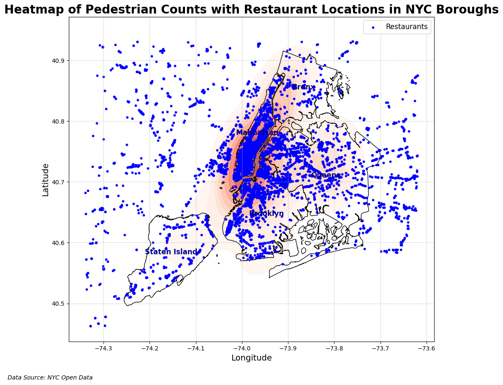
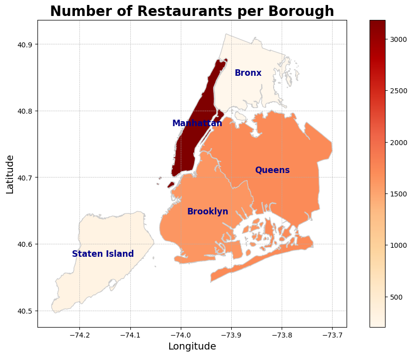
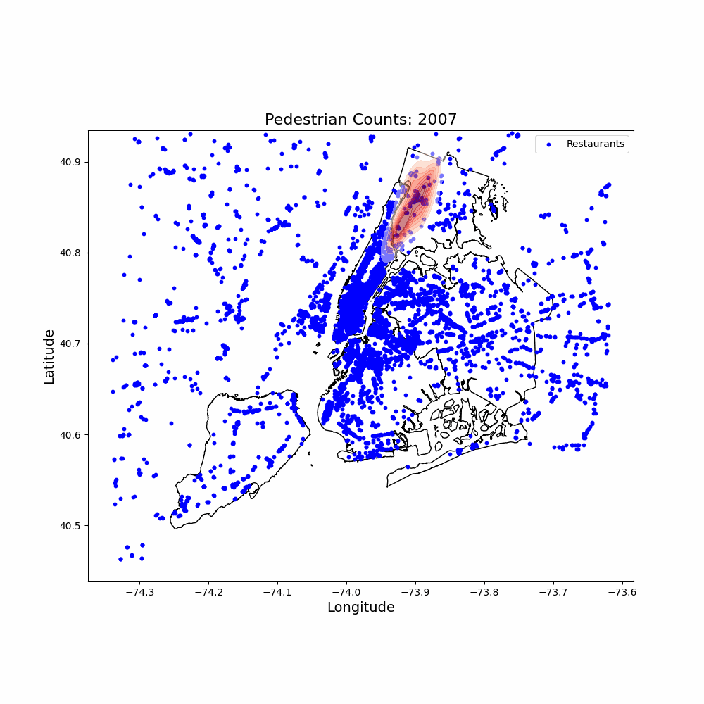

# Geospatial Data Analysis for Retail Optimization


## Project Overview
This project focuses on analyzing geospatial data using Python libraries such as GeoPandas and Folium. The goal is to map customer distributions, store locations, and traffic flows to identify optimal locations for new retail stores in New York City. By visualizing pedestrian counts and restaurant locations, we aim to provide actionable insights for optimizing store locations and marketing strategies.

## Table of Contents
1. [Introduction](#introduction)
2. [Data Sources](#data-sources)
3. [Installation](#installation)
4. [Features](#features)
5. [Visualizations](#visualizations)

## Introduction
In this project, we conduct a comprehensive geospatial analysis using pedestrian count data, restaurant locations, and borough boundaries of New York City. The analysis includes creating heatmaps, interactive maps, and density plots to visualize foot traffic patterns and identify high-potential areas for new retail stores.

## Data Sources
- **NYC Open Data**: Bi-Annual Pedestrian Counts ([link](https://data.cityofnewyork.us/Transportation/Bi-Annual-Pedestrian-Counts/2de2-6x2h))
- **OpenStreetMap**: Restaurant locations
- **NYC Borough Boundaries**: GeoJSON file

## Installation
To run this project locally, follow these steps:

1. **Clone the repository**
   ```sh
   git clone https://github.com/HuseinGhadiali/Geospatial-Data-Analysis-for-Retail-Optimization.git
   cd Geospatial-Data-Analysis-for-Retail-Optimization
   ```
2. **Create and activate a virtual environment**
   ```sh
   python -m venv venv
   source venv/bin/activate   # On Windows use `venv\Scripts\activate`
   ```
3. **Install the dependencies and open the notebook**
   ```sh
   pip install geopandas folium matplotlib pandas shapely jupyter
   jupyter notebook Gpd_Restaurant_Analysis.ipynb
   ```
   The generated interactive maps (heatmaps, cluster maps, borough maps) are saved to [`output/`](output/).

## Features
- Heatmaps: Visualize pedestrian counts across different time periods.
- Interactive Maps: Explore foot traffic patterns and restaurant locations interactively.
- Density Plots: Identify high-density areas for potential store locations.
- Proximity Analysis: Analyze the distance between high foot traffic areas and existing restaurants.

## Visualizations
### Interactive Map for [Manhattan]
[Interactive Map](https://huseinghadiali.github.io/Geospatialwebsitehost/index.html)




